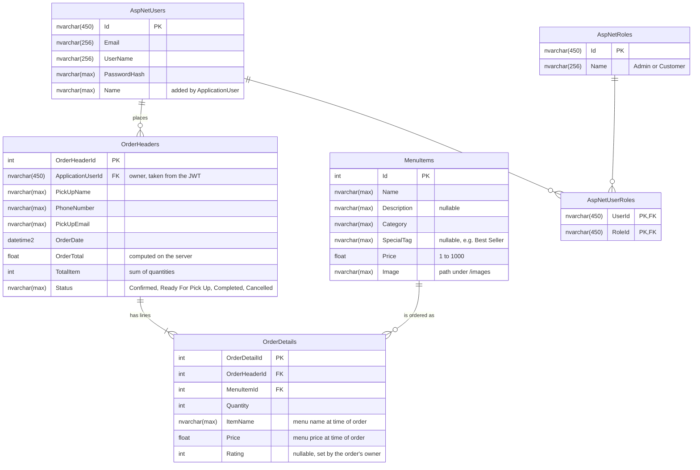

# Data model

The database is created by EF Core code-first migrations (`FromTheKitchen_API/Migrations`). It has four tables of its own plus the ASP.NET Core Identity tables. The diagram below matches the current model snapshot and uses SQL Server column types.

Identity's other tables (`AspNetUserClaims`, `AspNetUserLogins`, `AspNetUserTokens`, `AspNetRoleClaims`) exist but the app doesn't use them, so they're left out of the diagram.

## Notes

- **Order lines copy the name and price.** `OrderDetails.ItemName` and `Price` are copied from the menu when the order is placed, so changing a menu item later doesn't rewrite past orders. The server fills them in; whatever the client sends is ignored ([ADR 0004](adr/0004-server-is-source-of-truth-for-orders.md)).
- **Status is a plain string,** not a lookup table. The allowed values and transitions live in `Utility/SD.cs` and `OrderHeaderController` ([ADR 0004](adr/0004-server-is-source-of-truth-for-orders.md)).
- **Seed data:** the `MenuItems` table is seeded with 10 dishes in `ApplicationDbContext`. The `Admin` and `Customer` roles and the first Admin are created at startup by `AdminSeeder` ([ADR 0003](adr/0003-seed-first-admin-from-configuration.md)).
- **Every foreign key uses `ON DELETE CASCADE`** (the EF Core default for required relationships):
  - Deleting a user deletes their orders.
  - Deleting an order deletes its lines.
  - Deleting a menu item would delete every order line that used it. The API prevents that last case: `DELETE /api/MenuItem` returns 409 when the item appears in any order. A safer schema would use `ON DELETE RESTRICT` (`DeleteBehavior.Restrict`) for `OrderDetails.MenuItemId`.
- **Money is stored as `float`.** That's fine for display, but rounding can creep into totals. `decimal(10,2)` is the usual choice for prices.
